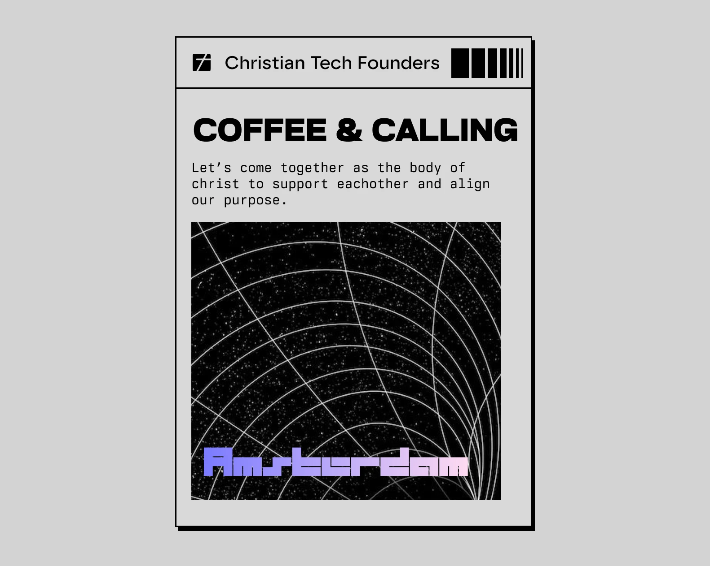

# Christian Entrepreneurs in Tech: How to Align Your Business With God

Christian entrepreneurs align their business with God by treating their talents as a gift to steward, building work that reflects His light, and refusing to build alone. For Christian entrepreneurs in tech, that means asking where your skills bear the most fruit, and finding people who help you answer honestly.

Many Christian founders live a split life. On Sunday you worship. On Monday you ship code, pitch investors and make calls about AI that will shape how people live. Few people around you understand both worlds, so the real questions stay unanswered. Is my company part of my calling? Am I using my gifts where God wants them?

We know that tension because we live it too. That is why Christian Tech Founders hosts Coffee & Calling, an evening in Amsterdam where Christian entrepreneurs in tech eat together, worship and talk honestly about calling. The next one is on Sunday 10 January 2027. [Sign up on Luma](https://luma.com/rnxcss9v).

## What is a Christian entrepreneur?

A Christian entrepreneur is a founder or business owner who sees their company as part of their calling from God. Profit matters, but it is not the point. The point is to steward what God gave you and to serve people well with it.

You see that view in everyday decisions. Who you hire. How you treat customers. What you refuse to build. What you do with the money. The Bible calls this stewardship. In 1 Peter 4:10, Peter writes: "Each of you should use whatever gift you have received to serve others, as faithful stewards of God's grace in its various forms."

## Why do Christian entrepreneurs in tech often feel alone?

Christian entrepreneurs in tech often feel alone because their two communities rarely overlap. Church friends may not follow startups, product roadmaps or AI. Tech peers may not understand why faith shapes your decisions. So you carry both, mostly in silence.

It does not help that a handful of large companies shape most of the technology people use every day, including the AI tools now showing up in every workflow. Christian builders, meanwhile, are scattered.

Without anyone to talk to, faith and work drift apart. It gets easy to keep God out of the office and the office out of prayer. Founders make hard calls about funding, hiring and ethics with nobody who shares their values to pray with first.

Loneliness is the part you feel. The part you do not see is talent that God gave for a purpose, sitting in the wrong place.

## How can you align your business with God?

You align your business with God by finding the right posture: holding your talents as a gift, using them where they create the most value for others, and staying close to Him and to other believers while you build. Three practices help.

### 1. Treat your talents as something to steward

In the parable of the talents (Matthew 25:14-30), the master praises the servants who put what they received to work and rebukes the one who buried it. Your skill in code, design, sales or leadership is no accident. Ask yourself often: where do my gifts create the most value for others?

### 2. Let your work reflect His light

A singer during worship can light up a whole room and carry the fruit of the Lord to many people at once. Technology works the same way, at a far larger scale. Jesus said, "You are the light of the world. A town built on a hill cannot be hidden" (Matthew 5:14). As God-led Christians in tech, we can reflect the light we receive in our relationship with Him through the products we build.

### 3. Build in community

Hebrews 10:24-25 calls believers to "spur one another on toward love and good deeds, not giving up meeting together." In our experience, calling gets clearer around a table with people who pray for you and are honest enough to push back on your ideas.

## What role do Christian entrepreneurs have in AI and technology?

Christian entrepreneurs have a role in shaping AI and technology. If believers stay out of the rooms where products get designed, other people decide which values those products carry.

That does not mean every Christian founder needs to start an AI company. It means bringing faith-shaped questions into your work. Who does this product serve? Who could it harm? Does it treat people as made in the image of God? Together, Christians can create more space for God's presence in technology, one product and one decision at a time.

This is the theme of the sermon at Coffee & Calling: the current state of technology, AI and our role in the world.

## Coffee & Calling Amsterdam: a gathering for Christian entrepreneurs

Coffee & Calling is an evening in Amsterdam for Christian entrepreneurs and builders in tech. There is dinner, worship and a sermon on technology and AI. Most of all there is time to talk, and that is usually where the good stuff happens.

- **Date:** Sunday 10 January 2027
- **Time:** 18:00 to 22:00, with optional coworking from 13:00
- **Location:** Amsterdam. The exact address is on the [Luma event page](https://luma.com/rnxcss9v).

### What does the evening look like?

| Time | What happens |
| --- | --- |
| 13:00 | Optional: come and cowork with us in Amsterdam |
| 18:00 | Walk-in |
| 18:15 | Dinner |
| 19:00 | Short introduction |
| 19:20 | Open worship |
| 19:45 | Sermon on the current state of technology, AI and our role in the world |
| 20:30 | Discussion |
| 20:45 to 22:00 | Open time for the Lord to move through us. Chats, drinks and networking |

### How do you join?

1. Sign up on [Luma](https://luma.com/rnxcss9v).
2. Come for dinner, worship and the sermon.
3. Stay for the conversation and leave with a clear next step for your calling.

### Who is it for?

Coffee & Calling is for founders, developers, designers, investors and anyone who works in or with technology and takes their faith seriously. The evening is not only for Christians. If you feel drawn to it, or you are still exploring faith, you are welcome. Send us a message first if you like.

### Is there a cost?

Yes, there is a small ticket fee. It keeps no-shows down and covers the space and the food. You can see the current price on Luma.

## Where can Christian entrepreneurs find community?

Christian entrepreneurs find community through local gatherings, global networks and their own church. We think in-person meetings build the deepest trust. Sharing a meal and praying together does something a group chat cannot.

In Amsterdam, Christian Tech Founders hosts Coffee & Calling for founders and builders in tech. If you want something global, [Faith Driven Entrepreneur](https://faithdrivenentrepreneur.org/) runs groups, courses and a podcast for Christ-following entrepreneurs worldwide. And ask your own church whether it has a group for business owners. If it does not, maybe you are the one to start it.

## Frequently asked questions

### Can a Christian be an entrepreneur?

Yes. The Bible honors diligent, skilled work, and the parable of the talents in Matthew 25 commends the servants who put their resources to work. Many Christians see entrepreneurship as a way to steward their gifts and serve others.

### Is it wrong for Christian entrepreneurs to make a profit?

No. Scripture warns against the love of money (1 Timothy 6:10), not against profit itself. The goal is to earn honestly, treat people fairly and use the money wisely and generously.

### How do I know if my business is aligned with God?

Look at your posture and your fruit. Do you pray about decisions? Do you treat people with integrity? Do your gifts serve others? Talking this through with believers who understand business usually makes the answer clearer than thinking about it alone.

### Should Christians build with AI?

Christians can build with AI, and their presence matters. The key questions are what the product does to people and whether it respects them as made in the image of God. The sermon at Coffee & Calling explores this theme.

### Do I need to be a Christian to attend Coffee & Calling?

No. The evening is open to anyone who feels drawn to it, including people who are still exploring faith. If you have questions before signing up, send us a message.

### Where in Amsterdam is Coffee & Calling held?

Coffee & Calling takes place in Amsterdam. You can find the exact location on the Luma event page.

### Why is there a ticket fee?

The small fee reduces no-shows, so we can plan food and space well. All of it goes to the venue and the dinner.

### Is there a community for Christian entrepreneurs in the Netherlands?

Yes. Christian Tech Founders brings Christian founders and builders in tech together, with gatherings in Amsterdam such as Coffee & Calling.

## Your next step as a Christian entrepreneur

You do not have to build alone. If you are a Christian entrepreneur in tech looking for people who share your faith and your work, join us at Coffee & Calling in Amsterdam on Sunday 10 January 2027.

[Sign up on Luma](https://luma.com/rnxcss9v)

Not ready to sign up yet? [Read more about Christian Tech Founders](/).
