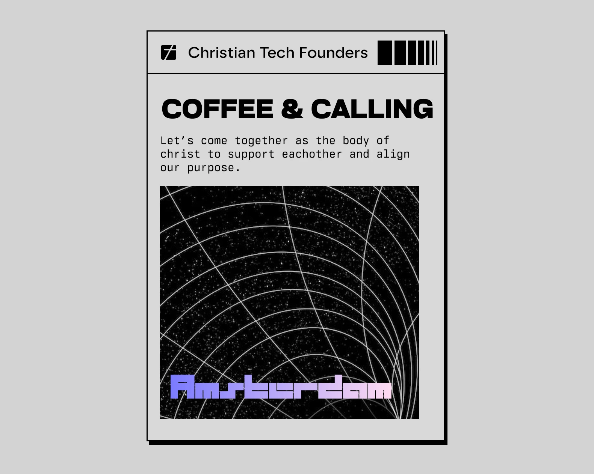

# Christelijke ondernemers in tech: zo stem je je bedrijf af op God

Christelijke ondernemers stemmen hun bedrijf af op God door hun talenten te zien als een geschenk om goed te beheren, door werk te bouwen dat Zijn licht weerspiegelt, en door niet alleen te bouwen. Voor christelijke ondernemers in tech betekent dat: je afvragen waar je vaardigheden de meeste vrucht dragen, en mensen vinden die je helpen daar eerlijk antwoord op te geven.

Veel christelijke founders leven een gespleten leven. Op zondag aanbid je. Op maandag ship je code, pitch je bij investeerders en neem je beslissingen over AI die bepalen hoe mensen leven. Weinig mensen om je heen begrijpen beide werelden, dus de echte vragen blijven liggen. Is mijn bedrijf onderdeel van mijn roeping? Gebruik ik mijn gaven waar God ze wil hebben?

We kennen die spanning, want we leven er zelf ook in. Daarom organiseert Christian Tech Founders Coffee & Calling: een avond in Amsterdam waar christelijke ondernemers in tech samen eten, aanbidden en eerlijk praten over roeping. De volgende is op zondag 10 januari 2027. [Meld je aan op Luma](https://luma.com/rnxcss9v).

## Wat is een christelijke ondernemer?

Een christelijke ondernemer is een founder of ondernemer die zijn bedrijf ziet als onderdeel van zijn roeping van God. Winst is belangrijk, maar het is niet het doel. Het doel is om goed te beheren wat God je gaf en mensen daarmee goed te dienen.

Je ziet dat terug in alledaagse keuzes. Wie je aanneemt. Hoe je klanten behandelt. Wat je weigert te bouwen. Wat je met het geld doet. De Bijbel noemt dit rentmeesterschap. In 1 Petrus 4:10 schrijft Petrus dat ieder de gave die hij ontvangen heeft moet gebruiken om anderen te dienen, als goede beheerders van Gods veelzijdige genade.

## Waarom voelen christelijke ondernemers in tech zich vaak alleen?

Christelijke ondernemers in tech voelen zich vaak alleen omdat hun twee werelden zelden overlappen. Vrienden in de kerk volgen misschien geen startups, roadmaps of AI. Collega's in tech begrijpen misschien niet waarom je geloof je keuzes bepaalt. Dus draag je allebei, meestal in stilte.

Het helpt ook niet dat een handvol grote bedrijven het grootste deel van de technologie bepaalt die mensen elke dag gebruiken, inclusief de AI-tools die nu in elke workflow opduiken. Christelijke bouwers zijn ondertussen versnipperd.

Zonder iemand om mee te praten drijven geloof en werk uit elkaar. Het wordt makkelijk om God buiten kantoor te houden en kantoor buiten je gebed. Founders nemen zware beslissingen over financiering, mensen en ethiek zonder iemand die hun waarden deelt om eerst mee te bidden.

Eenzaamheid is het deel dat je voelt. Het deel dat je niet ziet: talent dat God met een doel gaf, op de verkeerde plek.

## Hoe stem je je bedrijf af op God?

Je stemt je bedrijf af op God door de juiste houding te vinden: je talenten zien als een geschenk, ze inzetten waar ze de meeste waarde voor anderen hebben, en dicht bij Hem en bij andere gelovigen blijven terwijl je bouwt. Drie gewoontes helpen.

### 1. Zie je talenten als iets om goed te beheren

In de gelijkenis van de talenten (Matteüs 25:14-30) prijst de heer de dienaren die aan het werk zetten wat ze kregen, en berispt hij degene die het begroef. Er zijn duizenden dingen die je met je leven kunt doen. Wij geloven dat een roeping van God betekent dat je gaat staan op de plek die zo goed mogelijk aansluit bij de talenten die Hij je gaf. Je vaardigheid in code, design, sales of leiderschap is geen toeval. Vraag jezelf vaak af: waar creëren mijn gaven de meeste waarde voor anderen?

### 2. Laat je werk Zijn licht weerspiegelen

Zie je talenten als een caleidoscoop. Als je staat waar je gaven passen, schijnt Gods licht door jou heen op zoveel mogelijk mensen, zo sterk mogelijk. Een kok kan God meenemen in een diner, met gerechten vol verborgen betekenis die gasten ontdekken terwijl ze eten. Een zanger in de kerk kan een hele zaal meenemen in aanbidding. Iemand die van computers houdt kan God op honderd manieren dienen, maar de grootste impact komt meestal van bouwen met de vaardigheden en passie die God hem gaf. Technologie draagt dat licht op een veel grotere schaal. Jezus zegt in Matteüs 5:14 dat wij het licht van de wereld zijn, en dat een stad op een berg niet verborgen kan blijven. Als christenen in tech die door God geleid worden, kunnen we het licht dat we ontvangen in onze relatie met Hem weerspiegelen via de producten die we bouwen.

### 3. Bouw in gemeenschap

Hebreeën 10:24-25 roept gelovigen op om elkaar aan te sporen tot liefde en goede daden, en niet weg te blijven van de samenkomsten. Onze ervaring: roeping wordt helderder aan tafel met mensen die voor je bidden en eerlijk genoeg zijn om je ideeën tegen te spreken.

## Waarom is aanbidding belangrijk voor christelijke ondernemers?

Aanbidding is belangrijk voor christelijke ondernemers omdat het je blik omhoog brengt. Ondernemen trekt je aandacht omlaag naar cijfers, deadlines en zorgen. Aanbidding richt je aandacht weer op wat trouw en blijvend is, en geeft God ruimte om je te veranderen.

Vraag jezelf dus eerlijk af: wat brengt jouw blik naar een lagere plek? Voor de meeste founders is het niet één groot ding. Het zijn honderd kleine dingen, van notificaties tot cashflow. Aanbidding is het moment waarop je die dingen niet langer je aandacht laat stelen en, zoals Hebreeën 12:2 het zegt, je ogen gericht houdt op Jezus.

Aanbidding voelt ook goed, en dat is prima. Maar het stopt niet bij een goed gevoel. Als we God ons laten veranderen, brengt aanbidding ons tot compassie, en compassie brengt ons tot missie en dienen. Voor een founder kan dat veranderen wat je bouwt en voor wie je het bouwt.

Daarom begint Coffee & Calling met aanbidding, voor de preek. We willen dit effect van aanbidding samen ontdekken.

## Welke rol hebben christelijke ondernemers in AI en technologie?

Christelijke ondernemers hebben een rol in het vormgeven van AI en technologie. Als gelovigen wegblijven uit de ruimtes waar producten ontworpen worden, bepalen anderen welke waarden die producten meedragen.

Dat betekent niet dat elke christelijke founder een AI-bedrijf moet starten. Het betekent dat je vragen vanuit je geloof meeneemt in je werk. Wie dient dit product? Wie kan het schaden? Behandelt het mensen als geschapen naar het beeld van God? In een wereld die vaak donker is, kunnen christenen meer ruimte claimen voor Gods aanwezigheid in technologie, één product en één beslissing tegelijk.

Dit is het thema van de preek op Coffee & Calling: de huidige stand van technologie, AI en onze rol in de wereld.

## Coffee & Calling Amsterdam: een avond voor christelijke ondernemers

Coffee & Calling is een avond in Amsterdam voor christelijke ondernemers en bouwers in tech. Er is diner, aanbidding en een preek over technologie en AI. Maar vooral is er tijd om te praten, en daar gebeurt meestal het mooiste.

- **Datum:** zondag 10 januari 2027
- **Tijd:** 18:00 tot 22:00, met optioneel coworken vanaf 13:00
- **Locatie:** Amsterdam. Het precieze adres staat op de [Luma-eventpagina](https://luma.com/rnxcss9v).
- **Ticket:** betaal wat je wilt, vanaf €0,50

### Hoe ziet de avond eruit?

| Tijd | Wat er gebeurt |
| --- | --- |
| 13:00 | Optioneel: kom met ons coworken in Amsterdam |
| 18:00 | Inloop |
| 18:15 | Diner |
| 19:00 | Korte introductie |
| 19:20 | Open aanbidding |
| 19:45 | Preek over de huidige stand van technologie, AI en onze rol in de wereld |
| 20:30 | Gesprek |
| 20:45 tot 22:00 | Open tijd waarin de Heer door ons heen kan bewegen. Gesprekken, drankjes en netwerken |

### Hoe doe je mee?

1. Meld je aan op [Luma](https://luma.com/rnxcss9v).
2. Kom voor het diner, de aanbidding en de preek.
3. Blijf voor het gesprek en ga naar huis met een duidelijke volgende stap voor je roeping.

### Voor wie is het?

Coffee & Calling is voor ondernemers die God op de eerste plek zetten en op een moderne manier willen bouwen: founders, developers, designers, investeerders en iedereen die technologie gebruikt en op zoek is naar frisse, gelijkgestemde mensen om samen met God goede dingen te doen. De avond is niet alleen voor christenen. Voel je je aangetrokken, of ben je nog zoekende in je geloof? Dan ben je welkom. Stuur ons gerust eerst een bericht.

### Wat kost het?

Je kiest zelf wat je betaalt, vanaf €0,50. Het ticket houdt no-shows laag, en wat je betaalt gaat naar de ruimte en het eten.

## Waar vinden christelijke ondernemers gemeenschap?

Christelijke ondernemers vinden gemeenschap via lokale bijeenkomsten, wereldwijde netwerken en hun eigen kerk. Wij denken dat ontmoetingen in het echt het diepste vertrouwen opbouwen. Samen eten en samen bidden doet iets wat een groepsapp niet kan.

In Amsterdam organiseert Christian Tech Founders Coffee & Calling en zondagavonden met aanbidding, gebed en talent alignment sessies voor founders en bouwers in tech. Je kunt ook een project meenemen: we helpen je het verder te brengen en delen het op onze site, zodat je financiering en mensen vindt om mee te bouwen. Zoek je iets wereldwijds? [Faith Driven Entrepreneur](https://faithdrivenentrepreneur.org/) heeft groepen, cursussen en een podcast voor ondernemers die Christus volgen, over de hele wereld. En vraag in je eigen kerk of er een groep is voor ondernemers. Zo niet, misschien ben jij degene die hem start.

## Veelgestelde vragen

### Kan een christen ondernemer zijn?

Ja. De Bijbel waardeert ijverig, vakkundig werk, en de gelijkenis van de talenten in Matteüs 25 prijst de dienaren die hun middelen aan het werk zetten. Veel christenen zien ondernemen als een manier om hun gaven goed te beheren en anderen te dienen.

### Is het verkeerd als christelijke ondernemers winst maken?

Nee. De Bijbel waarschuwt voor de liefde voor geld (1 Timoteüs 6:10), niet voor winst zelf. Het doel is eerlijk verdienen, mensen eerlijk behandelen en het geld wijs en gul gebruiken.

### Hoe weet ik of mijn bedrijf is afgestemd op God?

Kijk naar je houding en je vrucht. Bid je over beslissingen? Behandel je mensen integer? Dienen je gaven anderen? Erover praten met gelovigen die ondernemen begrijpen, maakt het antwoord meestal helderder dan er alleen over nadenken.

### Moeten christenen bouwen met AI?

Christenen kunnen bouwen met AI, en hun aanwezigheid maakt verschil. De belangrijkste vragen zijn wat het product met mensen doet en of het hen respecteert als geschapen naar het beeld van God. De preek op Coffee & Calling gaat over dit thema.

### Moet ik christen zijn om naar Coffee & Calling te komen?

Nee. De avond staat open voor iedereen die zich aangetrokken voelt, ook voor mensen die nog zoekende zijn in hun geloof. Heb je vragen voordat je je aanmeldt? Stuur ons een bericht.

### Waar in Amsterdam is Coffee & Calling?

Coffee & Calling vindt plaats in Amsterdam. De precieze locatie vind je op de Luma-eventpagina.

### Wat kost een ticket voor Coffee & Calling?

Je kiest zelf wat je betaalt, vanaf €0,50. Ook een klein ticket vermindert no-shows, zodat we eten en ruimte goed kunnen plannen. Alles gaat naar de locatie en het diner.

### Is er een gemeenschap voor christelijke ondernemers in Nederland?

Ja. Christian Tech Founders brengt christelijke founders en bouwers in tech samen, met bijeenkomsten in Amsterdam zoals Coffee & Calling.

## Je volgende stap als christelijke ondernemer

Je hoeft niet alleen te bouwen. Ben je een christelijke ondernemer in tech en zoek je mensen die je geloof en je werk delen? Kom dan naar Coffee & Calling in Amsterdam op zondag 10 januari 2027.

[Meld je aan op Luma](https://luma.com/rnxcss9v)

Nog niet klaar om je aan te melden? [Lees meer over Christian Tech Founders](/nl/).
